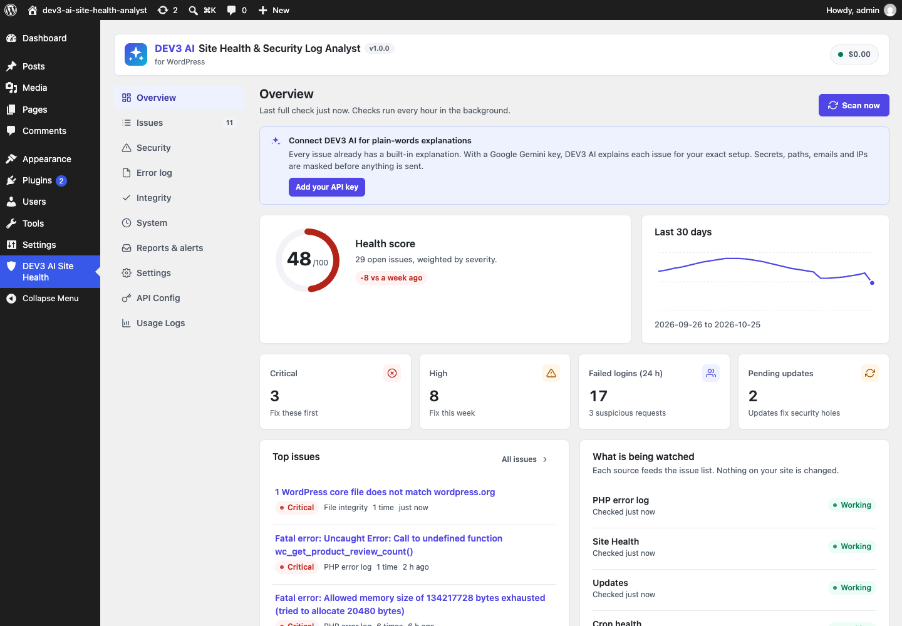

# DEV3 AI Site Health & Security Log Analyst for WordPress

Reads your PHP error log, Site Health, security events, updates, cron, slow queries and file integrity, groups everything into issues and explains each one in plain words.



## Features

DEV3 AI Site Health & Security Log Analyst turns the noise in your logs into a short, ranked list of issues, each with a plain-words explanation, the likely cause and step-by-step fixes.

It is **read-only by default**: it never changes your site on its own. Optional one-click fixes (deactivate a broken plugin, restore a changed core file, block an IP, remove an orphan scheduled task, disable XML-RPC) must be switched on in Settings, show a preview, need your confirmation and can be undone.

### What it collects
* PHP error log (debug.log or php.ini error_log): reads only new lines, notices log rotation and truncation, folds stack traces.
* WordPress Site Health results (on a schedule).
* Failed logins, brute-force attempts and suspicious requests (path traversal, SQL injection, .env/backup probes, user enumeration, 404 floods) with a lightweight logger.
* Plugin, theme and core changes, including changes made over FTP/SSH.
* Pending core/plugin/theme updates, inactive plugins, old PHP.
* WP-Cron health: overdue tasks, tasks without code, cron not running.
* Slow database queries when SAVEQUERIES is on.
* File integrity: core files and wordpress.org plugins against the official checksums.

### Issues, score, alerts and reports
* Repeated errors are grouped into one issue with a count and first/last seen; resolved issues re-open when they come back.
* A 0-100 health score with a 30-day trend.
* Email alerts for new fatal errors, new critical issues, changed files, failed-login and suspicious-request thresholds and a low score, with a cool-down.
* A weekly email report with an optional DEV3 AI summary.

### DEV3 AI (optional)
With your own Google AI API key, "Explain with DEV3 AI" writes a plain-words explanation for your exact setup, and you can ask follow-up questions. Before anything is sent, secrets (API keys, passwords, tokens, cookies, database credentials), absolute paths, emails, IP addresses, user names and your site address are masked. You can see exactly what is sent with "What is sent?". Without a key every issue still has a built-in explanation.

## Requirements

- WordPress 6.0 or newer (tested up to 6.8)
- PHP 7.4 or newer
- Optional: your own Google AI API key (from Google AI Studio) to switch on the DEV3 AI features. The rest of the plugin works without one.

## Installation

### From the release zip

1. Download `dev3-ai-site-health-analyst.zip` from the [latest release](https://github.com/dev3tech/dev3-ai-site-health-analyst/releases/latest).
2. In WordPress, go to **Plugins → Add New → Upload Plugin**, choose the zip and click **Install Now**.
3. Click **Activate**.

### Build from source

```bash
git clone https://github.com/dev3tech/dev3-ai-site-health-analyst.git
cd dev3-ai-site-health-analyst
composer install --no-dev
npm ci
npm run build
```

Then copy the `dev3-ai-site-health-analyst` folder into `wp-content/plugins/` and activate it.

### Getting started

1. Upload the plugin zip in Plugins → Add New → Upload, and activate it.
2. Open "DEV3 AI Site Health" in the admin menu and click "Scan now".
3. Optional: add a Google AI API key under API Config.
4. Optional: enable PHP error logging in wp-config.php (see the Overview screen for the lines to add).

## FAQ

### Does it change my site?
No. It is read-only unless you switch on "Allow one-click fixes", and even then each fix needs a confirmation and can be undone.

### Is my data sent anywhere?
Only when you click a DEV3 AI button (or enable the AI summary in the weekly report), a masked summary of that issue is sent to Google AI with your own API key. Integrity checks download checksums from wordpress.org.

### Does it replace a firewall?
No. It logs and explains; blocking is optional and limited to single IP addresses you choose.

## Documentation

The full HTML guide (installation, settings, hooks and FAQ) is in [`docs/index.html`](docs/index.html). Open it in a browser after cloning or downloading the repository.

## Changelog

### 1.0.0
* Initial release.

## Licence

Released under the GNU General Public License v2.0 or later (GPL-2.0-or-later). See [LICENSE](LICENSE).

## More from DEV3

- [DEV3 AI Site Health & Security Log Analyst for WordPress on the DEV3 Marketplace](https://www.dev3.tech/item/dev3-ai-site-health-analyst)
- [More WordPress plugins, themes and templates from DEV3](https://www.dev3.tech/marketplace)
